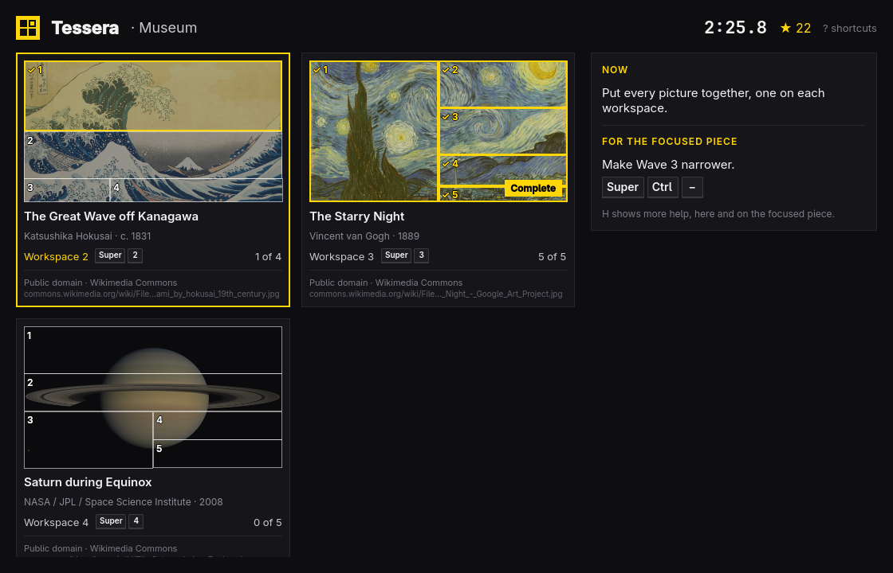
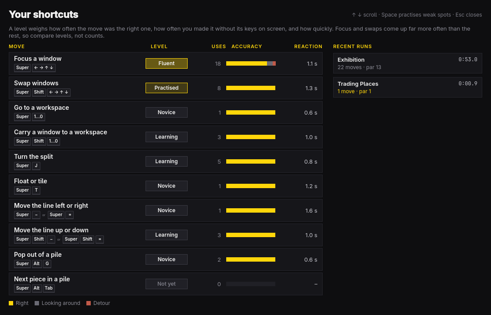

# Tessera



A jigsaw puzzle for [Omarchy](https://omarchy.org) that you solve with the
window shortcuts you'd otherwise never learn. Every piece of a picture is a
window of its own, and each one stretches its slice of the picture over
whatever tile Hyprland gives it, so a picture only comes together when every
piece is in the right place at the right size. You put it together with the
real keys: swap, focus, move to a workspace, toggle the split, resize, float
and tile, take windows out of a group, the scratchpad.


## Playing

Start with the nine lessons. Each teaches one move with a tiny puzzle:

| Lesson | The move |
|---|---|
| Trading Places | Swap windows (Super+Shift+arrows) |
| Look Around | Move focus (Super+arrows), then swap |
| Turning the Line | Toggle the split (Super+J) |
| Lost and Found | Go to a workspace and carry a window home (Super+N, Super+Shift+N) |
| Afloat | Tile a floating window (Super+T) |
| The Pile | Take windows out of a group (Super+Alt+G, Super+Alt+Tab) |
| Golden Section | Resize sideways (Super+Minus / Super+Equal, with Alt or Ctrl) |
| High and Low | Resize up and down (Super+Shift+Minus / Equal) |
| Out of Sight | The scratchpad (Super+Alt+S, Super+S) |

Lessons hold the answer back: first the goal, then what to do, then the keys,
then why. Solve one before the keys show and you get three stars.

Finish the lessons and the timed puzzles open: Gallery (two pictures),
Exhibition (two pictures with turned splits, odd sizes, a pile and the
scratchpad) and Museum (three pictures, piles, the scratchpad and a stray
piece from a picture that isn't there). Your best time for each is kept.

Every Exhibition and Museum deal needs each family of moves at least once:
swap, focus, a workspace switch, carrying a window to a workspace, turning
a split, tiling a floating window, taking a pile apart, resizing both ways,
and the scratchpad. The first split of the first picture is always turned
against how dwindle deals it, a split each way is off centre, and that
picture's own pieces arrive out of order; the tests check this over
hundreds of seeds and play a dozen deals to the end to see every family
turn up.

**Practice weak spots** (in the menu once the lessons are done) deals a
two-picture puzzle made of the moves your stats say you're least sure of:
the two weakest families always, the others more often the weaker they are.
Its keys show after a moment, or when you press H, so you get to try first.

Every hint uses your own chords, read from `omarchy-menu-keybindings
--print`, with Omarchy's defaults for anything you haven't bound.

### The hint

The board's hint panel, and a strip on the focused piece, say what that piece
needs right now: carry it to its workspace, tile it, pop it out of the pile,
swap it towards its place, turn the split beside it, make it wider. Press H
for more, Esc on a piece hides the strip.

### Pictures from anywhere

Press P in the menu to choose where pictures come from:

| Source | What it is |
|---|---|
| Mixed (default) | The built-in works, museum art and your folder together |
| Built-in | The five public-domain works compiled into Tessera; works offline |
| Museums online | Public-domain art from the Art Institute of Chicago and the Met |
| My folder | The JPEG, PNG and WebP files in one folder of yours |

Every picture is made to the shape of the monitor the board is on (its
size, scale, rotation and the bar's reserved strip, from `hyprctl -j
monitors`), since the pieces stretch over tiles that fill that screen. A
source image close enough to that shape (keeping at least 80% of it) is
cropped to the middle; anything else becomes a collage of two to four
images in justified rows or columns, every cell cropped to fit, with thin
gutters. This runs off the UI thread. The board credits every work in a
picture: title, artist, date, licence, where it's from and its page.

Lessons always use the built-in works, so they play the same everywhere.

### Online, and what it sends

Online art is on by default; O in the pictures screen turns it off, and
`TESSERA_OFFLINE=1` keeps Tessera off the network whatever the setting. The
header says when it's going online, and to which museum.

- It only talks HTTPS to `api.artic.edu`, `www.artic.edu`,
  `collectionapi.metmuseum.org` and `images.metmuseum.org`, redirects
  included, and only uses objects the museum flags public domain
  (`is_public_domain`, `isPublicDomain`); both release those under CC0.
- Each fetch is a handful of requests: one search, then one image per new
  picture (at most six). Requests time out after 15 seconds and a whole
  fetch after a minute; JSON is capped at 2 MB and images at 16 MB.
- Fields are checked before use, and nothing a museum sends is put into a
  URL or shown as markup. Images must be JPEG, PNG or WebP, between 400 and
  12000 pixels a side, and are re-encoded by Tessera before they're kept.
- The User-Agent is `Tessera/<version> (jigsaw puzzle)`; nothing about you,
  your machine or your pictures is sent.
- Downloads and rendered pictures live in `~/.cache/tessera/` (with a
  `credits.json` index), written atomically and kept under 200 MB by
  deleting what was used longest ago.

Offline, or when the museums can't be reached, the puzzle uses the
built-in pictures and the window says so.

### Your own folder

F in the pictures screen opens the desktop's folder chooser
(xdg-desktop-portal). Tessera reads the JPEG, PNG and WebP files directly in
it (not below it, at most 200), never writes to them, and never sends them
anywhere. Pictures made from them are kept in memory only, not in the cache.
The folder is remembered in `~/.local/state/tessera/settings.json`.

### Your shortcut stats



S in the menu shows how you use each kind of move. Tessera can't see the
keys (Hyprland takes every Super chord first), so it reads what each one
did:

- from Hyprland's events: switching workspace, carrying a window to a
  workspace or the scratchpad, floating and tiling, grouping, going into
  and out of a group, the next tab in a group, showing the scratchpad, and
  focus;
- from comparing the windows a poll apart: a swap, a turned split, and a
  resize, with its direction and how far.

Each move is judged against the hint at that moment: **right** when it's
what the hint recommended or makes measurable progress (a piece home,
tiled, in place, or a tile of the spiral holding the right piece), **looking
around** when it's a focus or workspace move that brings the needed piece
closer, and a **detour** when it undoes progress or doesn't help. For every
kind of move Tessera keeps the uses, right / looking around / detours, how
often its keys were on screen or you'd asked for help, the median time from
the situation arising (the hint changing, or your last move) to the move,
and when you last used it. Each run keeps its time and moves against par:
the fewest changing moves the deal can take (looks don't count). They're in
`~/.local/state/tessera/stats.json`; `progress.json` keeps its old shape.

The level weighs being right and needing no help; volume only builds
confidence in that:

```
n          = right + looking around + detours
accuracy   = (right + looking around / 2) / n
unaided    = 1 - (uses with its keys shown or after asking for help) / n
pace       = clamp((8 s - median reaction) / 6.5 s, 0, 1)
experience = 1 - e^(-n / 6)
score      = 100 × experience × accuracy × (0.6 + 0.3 × unaided + 0.1 × pace)
```

Novice below 20, Learning from 20, Practised from 40, Fluent from 60, Master
from 80. Always following shown keys tops out at Fluent, and being right
half the time tops out at Practised however often you do it. Focus and swaps
come up far more often than the rest, so the screen leads with the level,
not the count. A solved puzzle's biggest piece shows moves against par and
the kinds of move that went best and worst.

What it can't tell apart:

- A focus change made by clicking a window is only told from a keyboard one
  by the pointer: Hyprland warps it to the middle of a window focused from
  the keyboard (unless `cursor:no_warps` is set), so a pointer that moved
  and rests elsewhere means the mouse. With warps off, or a click right in
  the middle of a window, they look the same. Clicking a workspace in the
  bar can't be told from Super+N if the pointer ends on a window's middle.
- A swap or resize dragged with the mouse is left out the same way; one
  made from the keyboard while the pointer also moved can be too.
- Several resize presses inside one poll (a quarter second) read as one
  longer resize; a held key that repeats is one move.
- Alt+Tab and a directional focus that land on the same window look alike;
  a move between tiles counts as directional, one involving a floating
  window as Alt+Tab.
- Moves made within a moment of the game acting (dealing, bringing the
  board up) aren't counted, nor are moves from or to windows that aren't
  pieces.

### How the cuts work

Hyprland's dwindle layout only ever splits one tile in two, so every picture
is cut the way dwindle grows: a spiral, each split halving the tile left over
by the one before, some turned the other way or moved off centre. Every cut
can be built with the shortcuts, and the tests play every lesson and dozens
of shuffled puzzles to the end by doing nothing but what the hints say.

A piece in the wrong branch of the spiral can't be swapped into place, since
swaps keep the shape. It moves the long way: tucked into a pile next to it,
the pile swapped into the last tile, and popped out there.

### Your windows are safe

Tessera only ever acts on its own windows, checked by process id and address
right before each request. Pieces are dealt on empty workspaces of the
monitor the board is on; if there aren't enough, the game says which it needs
and waits. It never moves, closes or focuses anything of yours, and if one of
your windows lands in a picture, it tells you rather than touching it.
Quitting closes every piece; so does a crash, since they're its windows.

## Shortcuts

| Key | Does |
|---|---|
| Space | Start, deal, next |
| H | More help for the focused piece |
| S | Your shortcut stats (from the levels) |
| P | Where pictures come from (from the levels) |
| O | Online art on or off (in the pictures screen) |
| F / X | Choose a folder / forget it (in the pictures screen) |
| R | Deal the level again |
| Esc | Back to the levels |
| ? | Every shortcut, with your chords |
| Q | Quit (asks first mid-puzzle) |
| ↑ ↓ | Choose a level, a source, or scroll the stats |

## Building

```sh
bin/build      # build/tessera
bin/test       # the tests, offscreen
bin/install    # builds the package and installs it
```

Tessera needs Hyprland with the dwindle layout (Omarchy's default). It
follows the Omarchy theme's accent, Hyprland's window rounding, and the
language picked under Setup > Language (English, Danish and German so far).
Progress is kept in `~/.local/state/tessera/progress.json`, stats in
`stats.json` and the picture settings in `settings.json` beside it.

## Credits

The built-in pictures are public domain works by Hokusai, Van Gogh, Monet,
Bierstadt and NASA/JPL; [CREDITS.md](CREDITS.md) lists each with its source
and licence. Museum art is credited on the board as it's shown. The package installs it beside the license in
`/usr/share/licenses/tessera/`.

## License

MIT. See [LICENSE](LICENSE).
