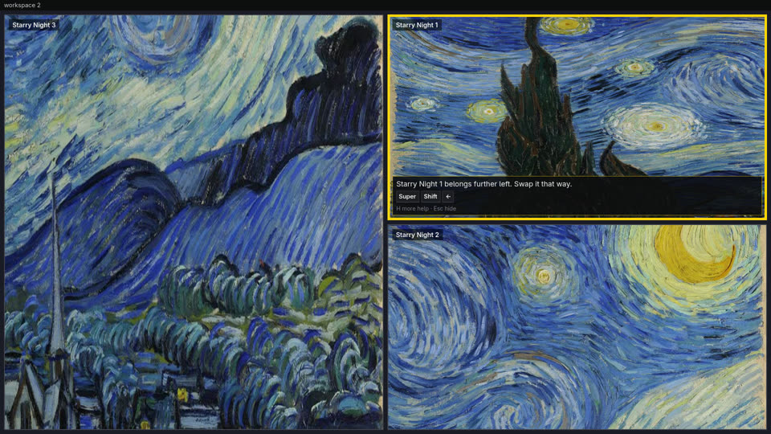

# Tessera


A jigsaw puzzle for [Omarchy](https://omarchy.org) that you solve with the
window shortcuts you'd otherwise never learn. Every piece of a picture is a
window of its own, and each one stretches its slice of the picture over
whatever tile Hyprland gives it, so a picture only comes together when every
piece is in the right place at the right size. You put it together with the
real keys: swap, focus, move to a workspace, toggle the split, resize, float
and tile, take windows out of a group, the scratchpad.



## Playing

Start with the nine lessons. Each teaches one move with a tiny puzzle:

| Lesson | The move |
|---|---|
| Trading Places | Swap windows (Super+Shift+arrows) |
| Look Around | Move focus (Super+arrows), then swap |
| Turning the Line | Toggle the split (Super+J) |
| Lost and Found | Go to a workspace and carry a window home (Super+N, Super+Shift+N) |
| Afloat | Tile a floating window (Super+T) |
| The Pile | Take windows out of a group (Super+Alt+G, Super+Alt+Tab) |
| Golden Section | Resize sideways (Super+Minus / Super+Equal, with Alt or Ctrl) |
| High and Low | Resize up and down (Super+Shift+Minus / Equal) |
| Out of Sight | The scratchpad (Super+Alt+S, Super+S) |

Lessons hold the answer back: first the goal, then what to do, then the keys,
then why. Solve one before the keys show and you get three stars.

Finish the lessons and the timed puzzles open: Gallery (two pictures),
Exhibition (two pictures with turned splits, odd sizes and a pile) and
Museum (three pictures, piles, the scratchpad and a stray piece from a
picture that isn't there). Your best time for each is kept.

Every hint uses your own chords, read from `omarchy-menu-keybindings
--print`, with Omarchy's defaults for anything you haven't bound.

### The hint

The board's hint panel, and a strip on the focused piece, say what that piece
needs right now: carry it to its workspace, tile it, pop it out of the pile,
swap it towards its place, turn the split beside it, make it wider. Press H
for more, Esc on a piece hides the strip.

### How the cuts work

Hyprland's dwindle layout only ever splits one tile in two, so every picture
is cut the way dwindle grows: a spiral, each split halving the tile left over
by the one before, some turned the other way or moved off centre. Every cut
can be built with the shortcuts, and the tests play every lesson and dozens
of shuffled puzzles to the end by doing nothing but what the hints say.

A piece in the wrong branch of the spiral can't be swapped into place, since
swaps keep the shape. It moves the long way: tucked into a pile next to it,
the pile swapped into the last tile, and popped out there.

### Your windows are safe

Tessera only ever acts on its own windows, checked by process id and address
right before each request. Pieces are dealt on empty workspaces of the
monitor the board is on; if there aren't enough, the game says which it needs
and waits. It never moves, closes or focuses anything of yours, and if one of
your windows lands in a picture, it tells you rather than touching it.
Quitting closes every piece; so does a crash, since they're its windows.

## Shortcuts

| Key | Does |
|---|---|
| Space | Start, deal, next |
| H | More help for the focused piece |
| R | Deal the level again |
| Esc | Back to the levels |
| ? | Every shortcut, with your chords |
| Q | Quit (asks first mid-puzzle) |
| ↑ ↓ | Choose a level |

## Building

```sh
bin/build      # build/tessera
bin/test       # the tests, offscreen
bin/install    # builds the package and installs it
```

Tessera needs Hyprland with the dwindle layout (Omarchy's default). It
follows the Omarchy theme's accent, Hyprland's window rounding, and the
language picked under Setup > Language (English, Danish and German so far).
Progress is kept in `~/.local/state/tessera/progress.json`.

## Credits

The pictures are public domain works by Hokusai, Van Gogh, Monet, Bierstadt
and NASA/JPL; [CREDITS.md](CREDITS.md) lists each with its source and
licence. The package installs it beside the license in
`/usr/share/licenses/tessera/`.

## License

MIT. See [LICENSE](LICENSE).
